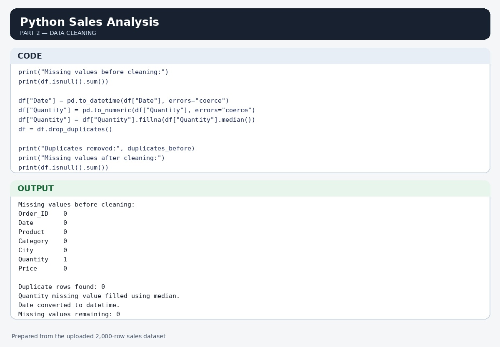
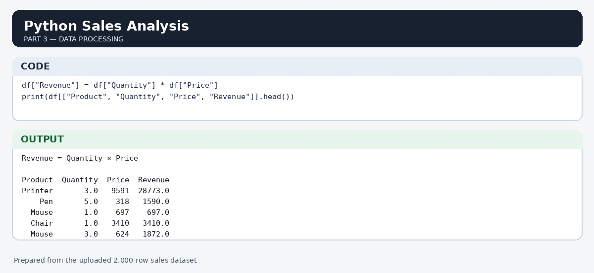
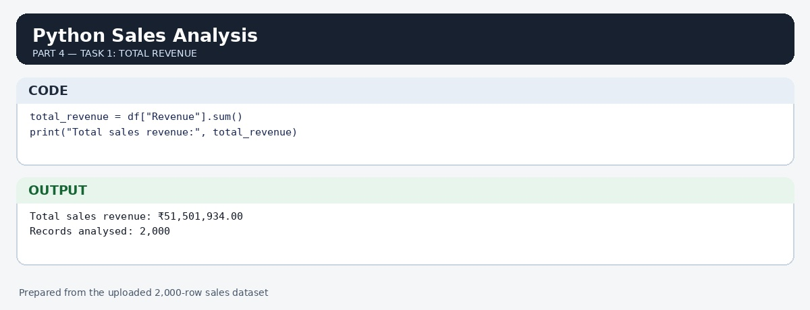
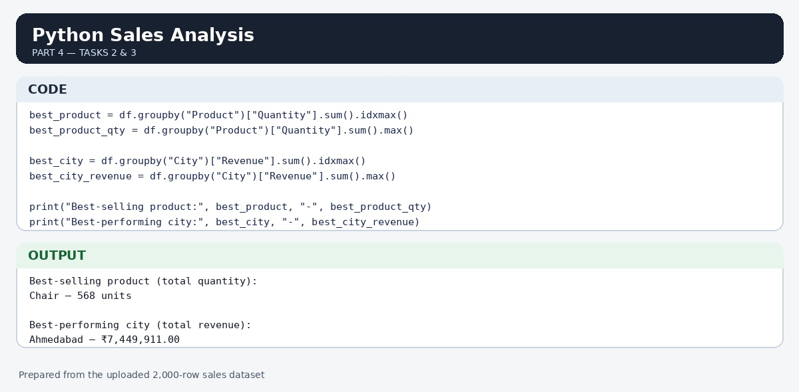
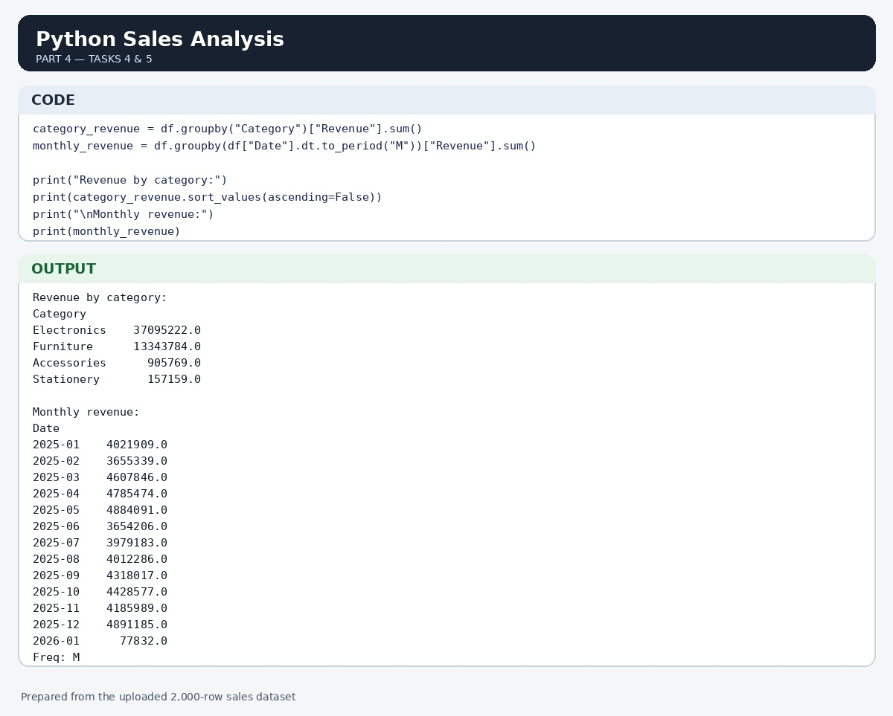

# Online Sales Analysis

## 📌 Project Overview
An end-to-end data analysis project focused on cleaning, transforming, and visualizing online store sales performance to uncover key revenue drivers and category trends.

---

## 📊 Visualizations & Insights

### 1. Data Preprocessing & Cleaning

### 2. Revenue Performance

### 3. Regional & Product Category Insights

---

## 🛠️ Tools Used
* **Python / MS Excel**: Data Cleaning & Preprocessing
* **Power BI**: Interactive Data Visualizations & Analytics
